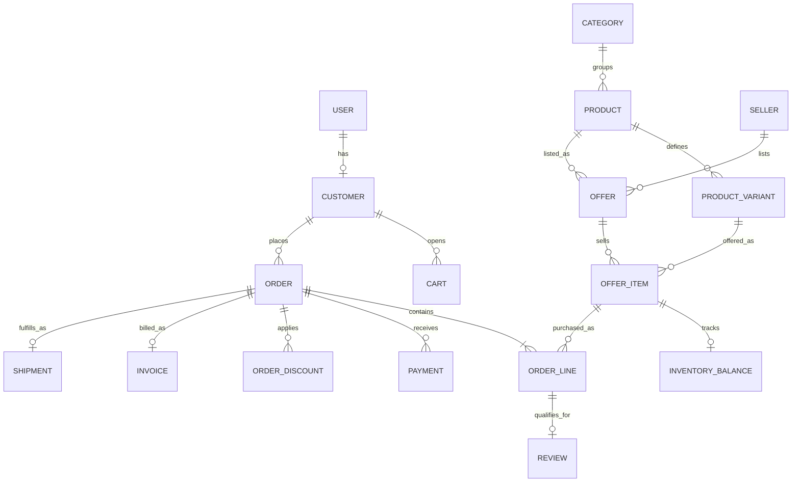

# Canonical shared shop database

The shared PostgreSQL database represents the shop as a whole. A product, customer, order, and payment each have one canonical identity. Every feature uses those identities through agreed service interfaces. The class still needs to name who can change each kind of record. See the [application schema](../../prisma/schema.prisma) and the [refactor plan](../superpowers/plans/2026-11-28-shared-shop-integration.md).

## How the records connect



Two sellers can sell the same product. `Product` and `ProductVariant` describe what is sold, while `Offer` and `OfferItem` carry who sells it and at what price. Each sellable offer item has one stock balance. A simple product gets one default variant. A cart and an order both refer to the same offer item. Order lines retain the purchased description and price so editing a listing later preserves the historical order and invoice.

An invoice, payment, shipment, or applied discount records a different business fact about the same order. Storefront displays that order. Accounting invoices it. Logistics fulfills it. Reviews verifies a purchase against its line. Search and Analytics read from the same relationships rather than introducing separate catalog or sale records.

## Physical model and team use

| Area                  | Tables in the target                                                                                                                             | Teams using them                                                                                                                                                                                                              |
| --------------------- | ------------------------------------------------------------------------------------------------------------------------------------------------ | ----------------------------------------------------------------------------------------------------------------------------------------------------------------------------------------------------------------------------- |
| Identity and access   | `User`, `Session`, `Account`, `Verification`, `Role`, `Permission`, `UserRole`, `RolePermission`                                                 | Admin & Identity defines session and permission behavior; every protected feature uses it. The role models are conditional on the choice of identity authority.                                                               |
| Customers             | `Customer`, `CustomerAddress`, `CustomerContact`, `CustomerSegment`, `CustomerSegmentMember`                                                     | CRM manages profiles and segments; Storefront, Marketing, and Accounting consume their agreed projections. An order holds its own address snapshot.                                                                           |
| Catalog and sellers   | `Category`, `Product`, `ProductVariant`, `Seller`, `SellerMember`, `Offer`, `OfferItem`, `OfferImage`                                            | Admin & Identity and Marketplace agree how catalog edits and offer moderation work. Storefront and Search read the same catalog; Marketing scopes promotions to the same IDs.                                                 |
| Stock and checkout    | `InventoryBalance`, `InventoryReservation`, `Cart`, `CartItem`, `Order`, `OrderAddress`, `OrderLine`                                             | Storefront owns its UI. Checkout, order, and inventory write authority still needs class sign-off. Marketplace seller sales derive from order lines joined to their offers.                                                   |
| Pricing and campaigns | `Campaign`, `MarketingConsent`, `Promotion`, `PromotionProduct`, `PromotionCategory`, `DiscountCode`, `OrderDiscount`, `OrderDiscountAllocation` | Marketing defines promotions and eligibility. Checkout records applied amounts with the order; Accounting reads those same allocations. Consent history and newsletter delivery need a separate policy before implementation. |
| Payments and invoices | `Payment`, `Refund`, `Invoice`, `InvoiceLine`                                                                                                    | Accounting handles invoicing and refund bookkeeping. Confirm the payment writer and seller commission/payout policy before building those flows.                                                                              |
| Delivery and reviews  | `ShippingMethod`, `Shipment`, `ShipmentEvent`, `Review`                                                                                          | Logistics manages fulfillment; Storefront displays the result. Reviews & Ratings reads verified order lines and manages moderation.                                                                                           |
| Integration           | `OrderEvent`, `OrderEventDelivery`, `EventReceipt`                                                                                               | Order and payment providers use an outbox for delivery and consumer deduplication. The draft's unique order/type key is for one-time milestones. Repeatable event types need a separate operation key.                        |
| Derived reads         | Catalog, order, and inventory projections                                                                                                        | Search & Recommendations and Analytics & Reporting can start with agreed reads. A later index or materialized view can be rebuilt from canonical data.                                                                        |

Use integer minor units at rest for the new commerce model. The order currency applies to its payments and allocations. Snapshot prices, tax, and addresses at purchase, then agree which values Accounting must carry onto issued invoices. A settled refund is its own record linked to the payment. Reversals and historical invoices need clear policies before deployment.

The draft assumes one customer account per user, one offer per seller and product, one customer invoice and one shipment per order, and one review per purchased line. Approve these rules for the first class milestone. Guest checkout, multiple shipments, seller payouts, invoice credit notes, and the full review audit history may require extensions once their contracts are defined. Public offer reads must check the product, offer, seller, and sellable-item states. They should expose price and availability without private customer or seller data.

## Folder structure

```text
shop-solution/
├── prisma/
│   ├── schema.prisma          # canonical application models
│   └── migrations/            # one PostgreSQL migration history
├── src/
│   ├── app/                   # pages, route handlers, API composition
│   ├── server/                # Prisma client, auth, shared infrastructure
│   ├── shared/                # reusable UI and technical utilities
│   └── features/
│       ├── accounting/        # invoices and bookkeeping
│       ├── admin-identity/    # identity, permissions, catalog admin
│       ├── analytics-reporting/
│       ├── crm/
│       ├── logistics/
│       ├── marketing/
│       ├── marketplace/
│       ├── reviews-ratings/
│       ├── search-recommendations/
│       └── storefront/
└── docs/commerce/             # canonical design and migration planning
```

Use feature `server/index.ts` exports for cross-feature server calls. Validate writes with Zod and check actor permissions on the server. Feature folders organize code. They do not require matching table prefixes or a copy of shared data. FastAPI can keep serving the Logistics contract while transitioning its storage to the shared model.

## What changes in the current PRs

| Current proposal                                                                                                                    | Canonical destination                                                                                                                                                                                                                                                                                      |
| ----------------------------------------------------------------------------------------------------------------------------------- | ---------------------------------------------------------------------------------------------------------------------------------------------------------------------------------------------------------------------------------------------------------------------------------------------------------- |
| Marketplace [#24](https://github.com/rohit4242/shop-solution/pull/24) stores product details and stock on its offer                 | Split catalog facts into `Product` and `ProductVariant`, seller listings into `Offer` and `OfferItem`, and availability into `InventoryBalance`. Keep existing public IDs through an agreed mapping. Move image bytes to the approved storage adapter before switching readers to `OfferImage.storageKey`. |
| Marketplace sale-line record                                                                                                        | Derive seller sales from the canonical order lines and payment state. If a separate seller payout or Accounting acknowledgement is required, attach that specific fact to the order lines through an agreed relation.                                                                                      |
| Marketing [#23](https://github.com/rohit4242/shop-solution/pull/23) stores product/category arrays and discount amounts as decimals | Use relational promotion targets and integer amounts. Keep a compatibility adapter for the existing wire contract. Derive code use from applied, non-reversed discounts, and map per-line allocations by stable IDs.                                                                                       |
| Search mock catalog and synthetic purchase groups                                                                                   | Add a shared catalog reader first. Agree which paid and refunded orders qualify before using real co-purchases.                                                                                                                                                                                            |
| Logistics in-memory store                                                                                                           | Keep OpenAPI 1.3.0 behavior. When adopted, use canonical orders and shipments inside the service or through the agreed shared fulfillment interface.                                                                                                                                                       |
| Better Auth plus external Identity integration                                                                                      | Preserve the four Better Auth auth tables and the existing auth migration. Agree one permission authority and a subject mapping before application roles are used.                                                                                                                                         |

The [canonical shop migration](../../prisma/migrations/20261128030000_canonical_shop/migration.sql) adds the new tables and constraints after the existing Better Auth migration. It preserves the four auth tables and their records. Environments with data from the draft Marketing or Marketplace schemas need a separate mapping and backfill before switching their feature code to canonical tables.
